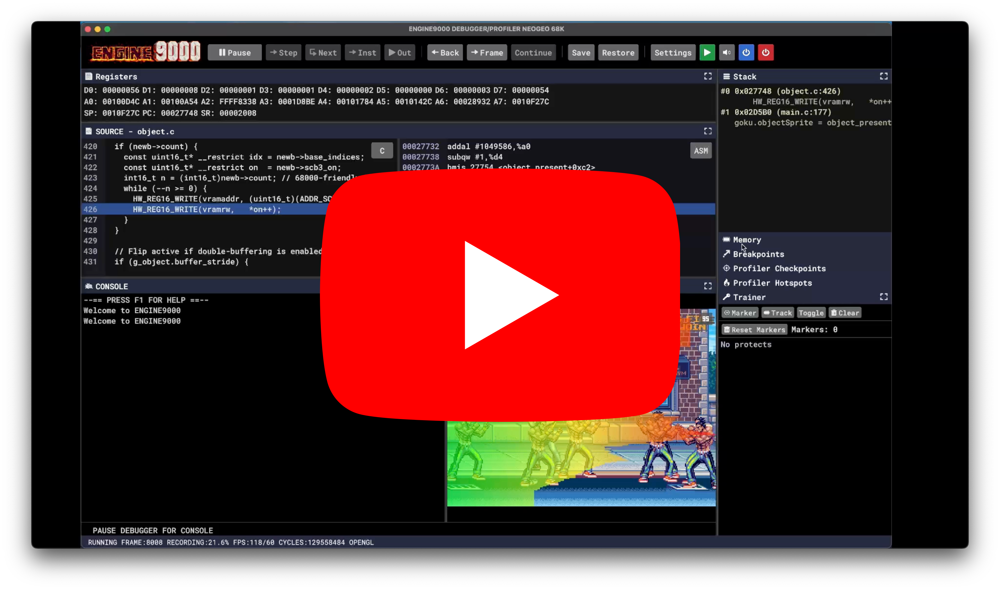
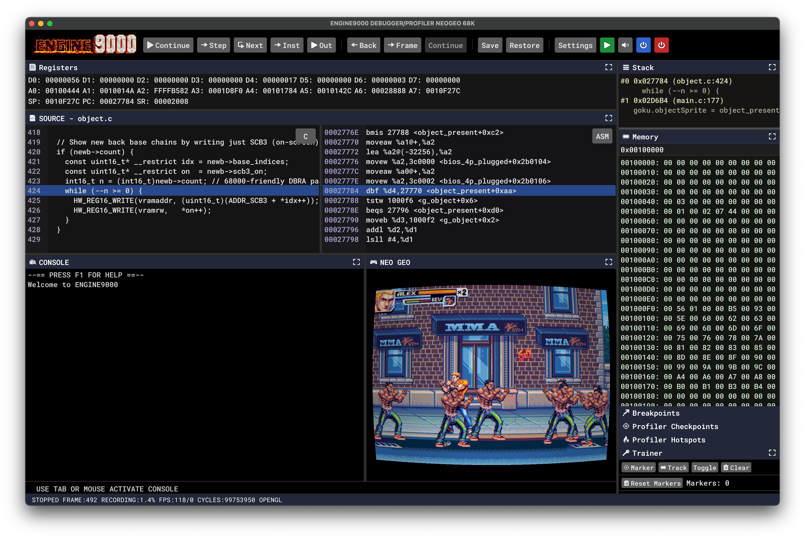
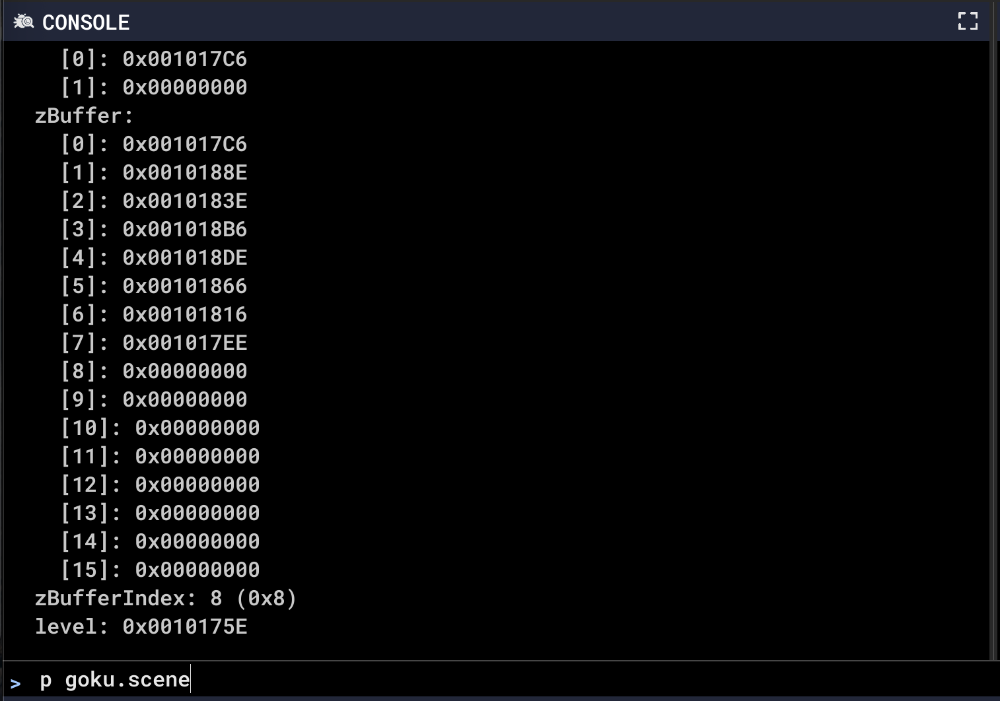
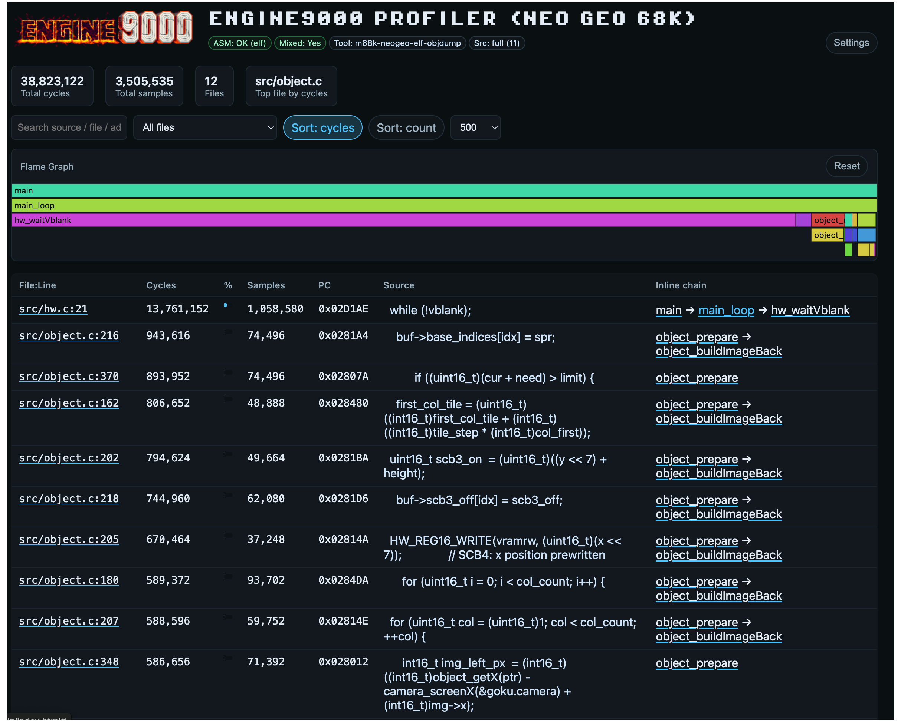
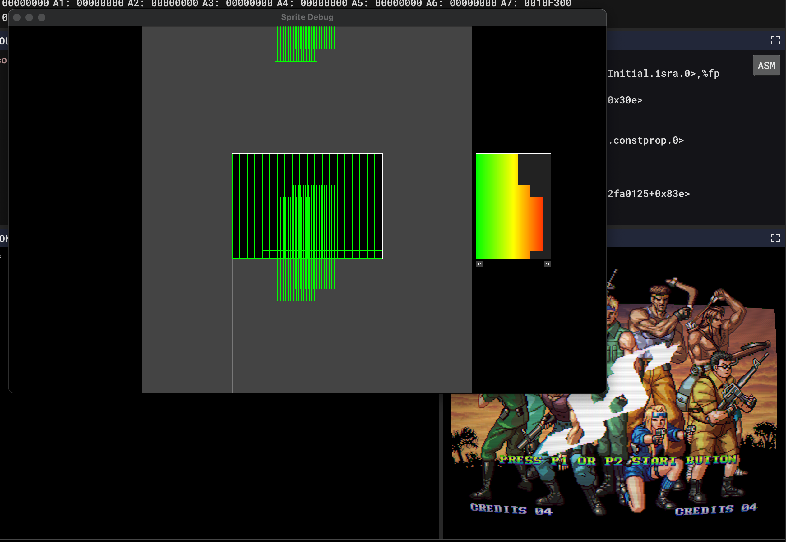

# ENGINE9000 68k/z80 Retro Debugger/Profiler

Amiga/Neo Geo/Mega Drive debugger/profiler - under heavy development so likely to be unstable for the time being. 

Expect file format changes, regressions and other incompatibilities with new versions. 

<table>
<tr>
<td align="center" width="50%">

 
<b>Neo Geo Trainer</b> 
Using the trainer for unlimited time and lives
</td>

<td align="center" width="50%">

 
<b>Amiga Debugging</b> 
Debug a system friendly Amiga program
</td>
</tr>
</table>

Project layout

- `e9k-debugger` - The debugger project
- `geo9000` - Neo Geo emulator - (forked from `geolith-libretro` https://github.com/libretro/geolith-libretro)
- `ami9000` - Amiga emulator - (fored from `libretro-uae` https://github.com/libretro/libretro-uae)
- `mega9000` - Mega Drive emulator (forked from `picodrive` https://git.libretro.com/libretro/picodrive

Platform support:

- macOS
- Windows via MSYS2
- Linux
- BSD

NOTE: Testing on Linux/Windows builds has been minimal at this stage.

---

## Overview

- ASM/C Source level debugger (ELF or stabs (bebbo gcc))
- Amiga/Neo Geo/Mega Drive emulators with frame level rewind/fast forward and simple CRT shader
- Source level profiler
- Trainer/cheat mode
- Smoke tester (record scenarios, replay, check video frames and audio identical)
- Debug peripherals for debug console and profile checkpoints
- Amiga hardware visualisers
- Neo Geo hardware visualisers
- Source level z80 debugger (z80) - see readme-z80.md for details

### Debugging Features

- UI or Console based debug
- ASM/C Syntax highlighting 
- File/function selection
- Pause / continue
- Step line / step instruction / next (step over) / step out
- Breakpoints by:
  - Absolute address
  - Symbol name
  - `file:line`
  - Clicking anywhere in the UI with an address
- Watchpoints, with filters such as:
  - Read/write/rw
  - Access size (`8|16|32`)
  - Address mask compare
  - Value/old-value/diff predicates
- Memory write (by address or by symbol)
- “Protect” (memory protection / cheat):
  - Block writes to an address (optionally sized)
  - Force a value at an address (optionally sized)
- Frame step
- Frame reverse
- Print variables

### Neo Geo Debug Peripherals

- `0xFFFF0` - characters written to this address will be output in the console and terminal
- `0xFFFEC` - write checkpoint slot index (`0-63`) for checkpoint profiling
- `0xFFE00` - checkpoint description array base (`uint32_t[64]`), write `description_ptr` to `0xFFE00 + index*4`
- These overlay with ROM addresses - other emulators or real neo geo might crash if you use these

### Mega Drive Debug Peripherals

- `0xFFFEC` - write checkpoint slot index (`0-63`) for checkpoint profiling
- `0xFFE00` - checkpoint description array base (`uint32_t[64]`), write `description_ptr` to `0xFFE00 + index*4`
- These overlay with ROM addresses - other emulators or real mega drive might crash if you use these

### Amiga Debug Peripherals

- `0xFC0000` - characters written to this address will be output in the console and terminal
- `0xFC0004` - writing a long word to this address sets this as the base address of the .text section
- `0xFC0008` - writing a long word to this address sets this as the base address of the .data section
- `0xFC000C` - writing a long word to this address sets this as the base address of the .bss section
- `0xFC0010` - writing a long word to this address sets a breakpoint at the written address
- `0xFC0014` - write a long word as the base address of section
- `0xFC0018` - write a long word as the type of section (`0` = text, `1` = data, `2` = bss)
- `0xFC001C` - write a long word size of section (commits the section)
- `0xFC0020` - write checkpoint slot index (`0-63`) for checkpoint profiling
- `0xFC0024` - write the word `0xDEAD` to this address exits the debugger
- `0xFC0028` - any write starts a smoke test configured with `--smoke-start-on-write` and/or a profiling session configured with `--profile-start-on-write`; does nothing otherwise
- `0xB7E900` through `0xB7E924` - read-only 32-bit debug argument registers 0-9, set with `--debug-arg VALUE`
- `0xB7E928` - read-only 32-bit current processor cycle count divided by 4
- `0xFC0100` - checkpoint description array base (`uint32_t[64]`), write `description_ptr` to `0xFC0100 + index*4`
- `0xFC0200` - counter name array base (`uint32_t[64]`), write `name_ptr` to `0xFC0200 + index*4` - counters display in status bar
- `0xFC0300` - counter value array base (`uint32_t[64]`), write `value` to `0xFC0300 + index*4`
- `0xFCxxxx` debug registers overlay ROM addresses; the `0xB7E900` argument block is mapped as an e9k-only debug peripheral outside ROM and outside the usual Zorro II fast RAM range. Other emulators or real Amiga might crash if you use these.

### Profiling Features

There are two complementary profiling mechanisms:

- **Streaming sampler profiler**: starts/stops sampling in the emulator.
  - Aggregates samples into “Profiler Hotspots”.
  - Analysis/export can emits a web bases results view.
- **Checkpoint profiler**: a fixed set of lightweight “checkpoints”.
  - Checkpoints are set by the target by writing to a fake peripheral
  - Captures per-checkpoint cycle segment stats (`current/avg/min/max`)
  - Captures checkpoint write scanline (`live/avg/min/max`)
  - Supports segment descriptions via fake register arrays; row N uses checkpoint N+1's description
  - Optional scanline overlay can be toggled from the checkpoint panel (Neo Geo and Amiga)

### Timeline / Rewind-Oriented Tools

The debugger keeps a rolling save-state timeline (“state buffer”) implemented as keyframes + diffs:

- You can use a hidden seek bar at the bottom of the emulator window to set the current frame
- When you release the seek bar, any stats saved ahead of the seek bar are trimmed
- If you want to be able to seek around without losing data, save state first "Save" from toolbar
- Restoring this with "Restore" will restore your full timeline
- Frame-step controls (frame stepping uses the state buffer)
- `loop` between two recorded frame numbers
- `diff` memory between two recorded frame numbers

### Automation / Regression Helpers

`e9k-debugger` includes first-class capture/replay tooling:

- Input recording to a file (`--record`) and replay (`--playback`)
- Smoke test recording (`--make-smoke`) and compare mode (`--smoke-test`)
  - Designed for “record inputs + frames + audio” and later replay/compare

### Neo Geo Debug Features

#### Sprite Debug

- Available via a hidden button in the emulator window - hover in top right hand corner to reveal
- Renders a full view of the Neo Geo coordinate space allowing visualsation of off screen sprites
- Renders a "sprite-line" histogram showing how close you are to hitting the Neo Geo sprites-per-line limits
- Displays a mini window showing non empty fix layer sprites
- Color sprites based on shink factor, palette usage, or sprite chain membership

#### RAM/ROM Visualiser

- View ram/rom as bitplane data
- Renders with selected palette when visible on screen

#### Palette Visualiser

- View all current palette sets as mini palette swatches
- Updates live allowing palette effects to be analysed

#### Audio Meter

- Display live audio levels from each audio source

### Amiga Custom Chipset Controls

- Very early controls for disabling various custom chipset functions

## Trainer
- Simple training function
- Set Markers, analyse which ram addresses have changed between marker
- Protect ram locations of interest (infinite lives etc)
- Protections for matching roms are persisted, reloaded

## Save States
- e9k-debugger automaically saves a save state every frame (differential) - this allows you to rewind/fast forward etc
- When you do a "Save/Restore" it saves the entire save state buffer - this will be saved in your configured "saves" folder on exit
- Save states include a hash of the rom
- When you start if a save state is available matching the filename and hash it will be loaded ready for a restore
- This restore will include full history

## Transitions
- e9k-debugger is a playground for me to play with transitions - if you don't like them, go to the settings screen and untick "fun"

## CRT Shader
- e9k-debugger includes a relatively simple CRT shader, a settings dialog is available via a hidden button in the emulator window. Hover in the top right hand corner to reveal.

---

## Controls

Clicking on a title bar collapses the panel, for horizontal panels click the icon to restore.

Global debugger hotkeys

| Key | Action |
|---|---|
| `F1` | Help |
| `F2` | Screenshot to clipboard |
| `F3` | Amiga <-> Neo Geo |
| `F4` | Toggle rolling state record |
| `F5` | Warp |
| `F6` | Toggle audio |
| `F7` | Save state |
| `F8` | Restore state |
| `F11` | Toggle hotkeys |
| `F12` | Toggle fullscreen |
| `ESC` | Close modal |
| `TAB` | Focus the console prompt |
| `c` | Continue |
| `p` | Pause |
| `s` | Step (source line) |
| `n` | Next (step over) |
| `i` | Step instruction |
| `b` | Frame step back |
| `f` | Frame step |
| `g` | Frame continue |
| `Ctrl/Gui+C` | Copy selection |
| `,` | Checkpoint profiler toggle |
| `.` | Checkpoint profiler reset |
| `/` | Checkpoint profiler dump to stdout |

---

## Console Commands

### `help` (alias: `h`)

SYNOPSIS  
`help [command]`

DESCRIPTION  
Lists available commands. With an argument, prints the help/usage for that specific command (aliases are accepted).

EXAMPLES  
`help`  
`help break`  
`help b`

---

### `break` (alias: `b`)

SYNOPSIS  
`break <addr|symbol|file:line>`

DESCRIPTION  
Adds a breakpoint. Resolution order is:

1. `file:line` 
2. Hex address (24-bit; `0x` prefix optional)
3. Symbol

NOTES  
Requires a configured ELF path (Settings → `ELF`, or `--elf PATH`).

EXAMPLES  
`break 0x00A3F2`  
`break player_update`  
`break foo.c:123`

---

### `continue` (alias: `c`)

SYNOPSIS  
`continue`

DESCRIPTION  
Resumes execution defocuses the console prompt.

---

### `cls`

SYNOPSIS  
`cls`

DESCRIPTION  
Clears the console output buffer.

---

### `step` (alias: `s`)

SYNOPSIS  
`step`

DESCRIPTION  
Steps to the next source line

---

### `next` (alias: `n`)

SYNOPSIS  
`next`

DESCRIPTION  
Steps over the next line

---

### `stepi` (alias: `i`)

SYNOPSIS  
`stepi`

DESCRIPTION  
Steps a single instruction

---

### `print` (alias: `p`)

SYNOPSIS  
`print <expr> [size=8|16|32]`  
`print addr <expr> [size=8|16|32]`

DESCRIPTION  
Evaluates and prints an expression using DWARF + symbol information from the configured ELF.

- `size=8|16|32` forces the memory read size when reading from a resolved address.
- `print addr <expr>` prints the resolved runtime address for an expression.

There is also a fast path for simple numeric expressions so that dereferences like `print *0xADDR` work even without an ELF:

- `print 1234`
- `print 0x00100000`
- `print *0x00100000`
- `print *(0x00100000)`

EXAMPLES  
`print playerLives`  
`print *0x00100000 size=16`  
`print addr playerLives`

---

### `write`

SYNOPSIS  
`write <dest> <value>`

DESCRIPTION  
Writes a hex value to an address or symbol.

- If `<dest>` looks like a hex address (`0x...`), it writes directly to that address.
- Otherwise `<dest>` is treated as a symbol and resolved via the expression/symbol resolver.

The write size is inferred from the number of hex digits in `<value>`:

- `0xNN` → 8-bit
- `0xNNNN` → 16-bit
- `0xNNNNNNNN` → 32-bit

NOTES  
`<value>` must be strict hex with a `0x` prefix.

EXAMPLES  
`write 0x0010ABCD 0xFF`  
`write someGlobal 0x0001`

---

### `watch` (alias: `wa`)

SYNOPSIS  
`watch [addr|symbol] [r|w|rw] [size=8|16|32] [mask=0x...] [val=0x...|value=0x...] [old=0x...] [diff=0x...|neq=0x...] [src=...]`  
`watch del <idx>`  
`watch clear`

DESCRIPTION  
Lists, adds, or removes watchpoints.

- With no arguments, prints the current watchpoint table plus the enabled mask.
- `watch clear` resets all watchpoints.
- `watch del <idx>` removes a watchpoint by index.
- Otherwise, adds a watchpoint at `<addr|symbol>` with the selected options.

OPTIONS  
`r`, `w`, `rw` select access type. If omitted, defaults to `rw`.  
`size=8|16|32` matches access size.  
`mask=0x...` applies an address compare mask.  
`val=0x...` or `value=0x...` matches a value equality operand.  
`old=0x...` matches an old-value equality operand.  
`diff=0x...` or `neq=0x...` matches “value != old” (with an operand).
`src=...` matches the access source. Valid values depend on the current target:

- Amiga: `cpu`, `blitter`, `copper`
- Neo Geo: `cpu`

NOTES
- The debugger only shows and accepts `src=` values that can currently be emitted by the active core.
- On Amiga, source tagging is not symmetric for all access types:
  - generic RAM writes are currently tagged as `cpu` or `blitter`
  - custom-register writes are currently tagged as `cpu`, `copper`, or `blitter`
  - reads are currently only tagged as `cpu`
- Some internal paths may still report `unknown`; this is not intended as a user-facing `src=` filter value.

EXAMPLES  
`watch`  
`watch 0x0010ABCD rw size=16`  
`watch playerLives w value=0x00000003`  
`watch 0x0010ABCD w val=0x00000010`  
`watch 0x00DFF180 w src=copper`  
`watch 0x00020000 w src=blitter`  
`watch del 3`  
`watch clear`

---

### `train`

SYNOPSIS  
`train <from> <to> [size=8|16|32]`  
`train ignore`  
`train clear`

DESCRIPTION  
Convenience command for “training” by breaking on a value transition.

- `train <from> <to>` installs a watchpoint that triggers when a write changes a value from `<from>` to `<to>`.
  - `<from>` and `<to>` accept decimal or `0x...` hex.
  - The watchpoint matches any address (mask `0`).
- `train ignore` adds the last triggered watchbreak address to an ignore list.
- `train clear` clears the ignore list.

EXAMPLES  
`train 3 2 size=8`  
`train 0x03 0x02`  
`train ignore`

---

### `protect`

SYNOPSIS  
`protect`  
`protect clear`  
`protect del <addr> [size=8|16|32]`  
`protect <addr> block [size=8|16|32]`  
`protect <addr> set=0x... [size=8|16|32]`

DESCRIPTION  
Manages “protect” rules:

- `block`: prevent writes to an address (optionally sized)
- `set=...`: force a value at an address (optionally sized)

With no arguments, prints the current enabled protect entries.

EXAMPLES  
`protect`  
`protect 0x0010ABCD block size=16`  
`protect 0x0010ABCD set=0x00000063 size=8`  
`protect del 0x0010ABCD size=8`  
`protect clear`

---

### `loop`

SYNOPSIS  
`loop <from> <to>`  
`loop`  
`loop clear`

DESCRIPTION  
Loops between two recorded frame numbers (decimal) in the state buffer. Both frames must exist in the state buffer.

NOTES  
The state buffer size is configurable via `E9K_STATE_BUFFER_BYTES` (see “Runtime Requirements”).

EXAMPLES  
`loop 120 180`  
`loop`  
`loop clear`

---

### `diff`

SYNOPSIS  
`diff <fromFrame> <toFrame> [size=8|16|32]`

DESCRIPTION  
Shows RAM addresses that differ between two recorded frames (state buffer), scanning:

- Main RAM (`0x00100000` .. `0x0010FFFF`)
- Backup RAM (`0x00D00000` .. `0x00D0FFFF`)

Output is truncated after 4096 lines.

EXAMPLES  
`diff 120 180`  
`diff 120 180 size=16`

---

### `transition`

SYNOPSIS  
`transition <slide|explode|doom|flip|rbar|random|cycle|none>`

DESCRIPTION  
Sets the transition mode used for startup and fullscreen transitions and persists it to the config.

EXAMPLES  
`transition random`  
`transition none`

---

### `base`
	
SYNOPSIS  
`base [text|data|bss] [addr|clear]`
`base clear`
	
DESCRIPTION  
Shows or sets the current runtime base address for each section (`text`, `data`, `bss`). These bases are used to translate between:
	

 - **Debug/symbol addresses** (what external resolvers like `addr2line`/`readelf`/`objdump` expect)
   
In general:
 - `debug_addr = runtime_addr - <sectionBase>`
 - `runtime_addr = debug_addr + <sectionBase>`
   
This is required for relocatable images, and affects source/symbol resolution and operations like breakpoints and `print` that depend on debug info.
	
NOTES  
  - `addr` accepts decimal or `0x...`.
  - `base` values are per-session (not persisted).

EXAMPLES  
  `base`
  `base text 0x00C0FE24`
  `base data 0x00C11320`
  `base bss 0x00C1138C`
  `base text`
  `base bss clear`
  `base clear`
  
---

## Runtime Requirements

### Neo Geo BIOS ROMs (required)

BIOS files are not included. You must supply a valid Neo Geo BIOS set in the **system/BIOS directory**.

- Default system directory: `./system`
- Set via Settings UI: `BIOS FOLDER`
- Or via CLI: `--system-dir PATH` (use `--neogeo` to force Neo Geo mode)

In this repo, the default `./system` directory corresponds to `e9k-debugger/system` when running from the `e9k-debugger` directory. In practice this is typically a BIOS archive such as `neogeo.zip` (MVS / UniBIOS) or `aes.zip` (AES), placed inside the system directory. Neo Geo CD media also requires `neocd.zip` for front/top loader mode or `neocdz.zip` for CDZ/CDZ UniBIOS mode.

### Game ROMS

`e9k-debugger` can load .neo files or attempt to automatically create a .neo file from a mame style rom set. Neo Geo CD `.cue` and `.chd` media can be loaded through the same ROM path setting.

- It uses two naming conventions:
  - the files with a rom specific file extension (.p1, .m1, .v1 etc)
  - the filename prior to the extension has a rom designation (rom-p1.bin)
- Use the ROM Folder to load mame style rom sets.

### Amiga Configuration

- Create an Amiga configuration by selecting "NEW" UAE file in the SETTINGS screen
- Amiga config is a combination of selecting PUAE core options (SETTIGNS->Core Options) and DF0/DF1/DH0 config on the settings screen
- Additional uae options can be manually added to the .uae file
- Not all PUAE core options make sense or will work (hotkeys for example) - I still haven't filtered these out
- Basic PUAE configs have been tested - large complex configs will not work well with the state saving buffer

### Amiga Kickstart ROMs (required)

- Kickstart ROMS are not included.
- A complete set of WHDLoad kickstart roms in your system folder is the best option.
- Otherwise manually settting kickstart roms in the .uae file is required.
- The AROS kickstart will be a fallback and may work depending on your usage.

### Linux/BSD

- zenity for file dialogs

### Toolchain 

For C source-level stepping, symbol breakpoints, and rich `print` expressions:

Configure your toolchain for each platform in the settings screen. Currently tested:

- Neo Geo - ngdevkit `m68k-neogeo-elf`
- Amiga - bebbo's amiga-gcc `m68k-amigaos`
- Mega Drive - mars/sgdk `m68k-elf`

Without these, the debugger can still run, but symbol/source-aware features degrade or become unavailable.

#### Neo Geo
- An ELF compiled with DWARF debug info (`Settings → ELF`, or `--elf PATH`)
- The Neo Geo toolchain binaries on `PATH`:
  - `m68k-neogeo-elf-addr2line`
  - `m68k-neogeo-elf-objdump`
  - `m68k-neogeo-elf-readelf`
  
#### Mega Drive
- An ELF compiled with DWARF debug info (`Settings → ELF`, or `--elf PATH`)
- The toolchain binaries on `PATH`:
  - `m68k-elf-addr2line`
  - `m68k-elf-objdump`
  - `m68k-elf-readelf`

#### Amiga
- To use bebbo's toolchain please use https://github.com/AmigaPorts/m68k-amigaos-gcc - it contains important fixes to addr2line
- An hunk compiled with amiga-gcc debug info 
- The amiga-os-gcc binaries on `PATH`:
  - `m68k-amigaos-addr2line`
  - `m68k-amigaos-objdump`
  
Note: Amiga debugging is complicated by relocation. If your target application is relocated you must inform the debugger of the base address of each section. This can be done with either"

- The `base` command - see "base" command documentation
- Makeing your custom loader use the Amiga fake perphierals - see "Amiga Debug Peripherals" section
- Use `load9000` or `load9013` amiga programs to load your hunk based exectuable - see "load9000" section

- An ELF image with dwarf information running on Amiga should technically work but is untested

### load9000 / load9013

A simple Amiga program is available in:

`tools/amiga/load9000`

These programs are run on the emulated Amiga and parse the hunk section table before loading the target and informing the debugger of the section base addresses.

`load9000` targets Kickstart 2.0+ `load9013` targets Kickstart 1.3.

`load9000 <hunk>`
`load9000 --break <hunk>`
`load9000 --stack <bytes> <hunk>`
`load9013 <hunk>`
`load9013 --break <hunk>`
`load9013 --stack <bytes> <hunk>`

### Config file + environment variables

Config is persisted automatically (layout + settings):

- macOS: `~/.e9k-debugger.cfg`
- Windows: `%APPDATA%\\e9k-debugger.cfg` (falls back to `%USERPROFILE%`)

Useful environment variables:

- `E9K_STATE_BUFFER_BYTES`: state buffer capacity (default is `512*1024*1024`)
- `E9K_PROFILE_JSON`: output path for profiler analysis JSON (otherwise a temp file is used)

### Command-line options

Run `e9k-debugger --help` for the full list. The current options include:

#### Global options
- `--help`, `-h`
- `--reset-cfg` (deletes the saved config file and restarts)
- `--amiga`, `--neogeo` (sets the active system; affects which config options apply)
- `--core PATH` (applies to the active system)
- `--system-dir PATH` (applies to the active system)
- `--save-dir PATH` (applies to the active system)
- `--source-dir PATH` (applies to the active system)
- `--audio-buffer-ms MS` (currently Neo Geo only)
- `--window-size WxH`
- `--record PATH`, `--playback PATH`
- `--make-smoke PATH`, `--smoke-test PATH`, `--smoke-start-on-write`, `--profile-start-on-write`, `--smoke-threshold N`, `--smoke-open`
- `--debug-arg VALUE` (repeat up to 10; Amiga reads these as 32-bit debug args at `0xB7E900 + index*4`)
- `--headless` - hide the main window (also disables rolling state recording by default)
- `--warp` - start in speed multiplier mode
- `--fullscreen` (alias: `--start-fullscreen`) - start in UI fullscreen mode (ESC toggle)
- `--no-rolling-record` - start with rolling state recording paused (can be toggled with `F4`; smoke/headless also pause by default)

#### Neo Geo options (use with `--neogeo`)
- `--elf PATH`
- `--rom PATH` (Neo Geo `.neo`, `.cue`, or `.chd` file)
- `--rom-folder PATH` (generates a `.neo`)
- `--aes`, `--mvs`, `--uni` (cartridge system type)
- `--cdz`, `--cd-front`, `--cd-top`, `--cdz-uni` (CD system type; CD media is selected by loading `.cue` or `.chd`)

#### Amiga options (use with `--amiga`)
- `--hunk PATH` (Amiga debug binary path)
- `--uae PATH` (Amiga UAE config `.uae` path)

---

## Copyright/License

e9k-debugger/ Copyright © 2026 Enable Software Pty Ltd

This project contains files with various licenses, unless otherwise specified (See Additional copyright information below) assume GNU General Public License, version 2.

---

## Building

Mega Drive core is in a separate repo (License seems incompatible with GPL/MIT) - so to add the git submodule use:

- `make mega9000-support`

### macOS (tested on 26.2)

Install xcode
- `xcode-select --install`

Install homebrew
- `/bin/bash -c "$(curl -fsSL https://raw.githubusercontent.com/Homebrew/install/HEAD/install.sh)"`

Install dependencies
- `brew install make sdl2 sdl2_image sdl2_ttf readline pkg-config`

Build
- `export PATH="$(brew --prefix make)/libexec/gnubin:$PATH"` (ensure we use gnu make, not default macOS make)
- `make mega9000-support`
- `make`

This should create:
- `e9k-debugger/e9k-debugger` - macOS executable
- `e9k-debugger/system/ami9000.dylib` - Amiga emulator core
- `e9k-debugger/system/geo9000.dylib` - Neo Geo emulator core
- `e9k-debugger/system/mega9000.dylib` - Mega Drive emulator core

- The macOS build currently links sanitizers (`-fsanitize=address,undefined`) by default; adjust the Makefile if you want a non-sanitized release build.

### Windows (msys2) 

Install msys2 (note: following the default install instructions will install ALOT of packages)

From MSYS2 MINGW64 Shell:
- `pacman -S mingw-w64-x86_64-toolchain`
- `pacman -S make git mingw-w64-x86_64-SDL2 mingw-w64-x86_64-SDL2_image mingw-w64-x86_64-SDL2_ttf mingw-w64-x86_64-readline mingw-w64-x86_64-pkgconf`
- `make mega9000-support`
- `make w64`

This should create:
- `e9k-debugger/e9k-debugger.exe` 
- `e9k-debugger/system/geo9000.dll`
- `e9k-debugger/system/ami9000.dll` 
- `e9k-debugger/system/mega9000.dll`

### Linux (Ubuntu/Debian)

- `apt install -y libsdl2-dev libsdl2-image-dev libsdl2-ttf-dev libreadline-dev pkg-config zenity`
- `make mega9000-support`
- `make`

This should create:
- `e9k-debugger/e9k-debugger` - Linux executable
- `e9k-debugger/system/ami9000.so` - Amiga emulator core
- `e9k-debugger/system/geo9000.so` - Neo Geo emulator core
- `e9k-debugger/system/mega9000.so` - Mega Drive emulator core

### BSD (FreeBSD)

- `pkg install gmake sdl2 sdl2_image sdl2_ttf readline pkgconf zenity`
- `gmake mega9000-support`
- `MAKE=gmake gmake`

This should create:
- `e9k-debugger/e9k-debugger` - BSD executable
- `e9k-debugger/system/ami9000.so` - Amiga emulator core
- `e9k-debugger/system/geo9000.so` - Neo Geo emulator core
- `e9k-debugger/system/mega9000.so` - Mega Drive emulator core

## Additional copyright information

- `geo9000/` Copyright © 2022-2024 Rupert Carmichael - BSD-3-Clause license (see below). See https://github.com/libretro/geolith-libretro
- `ami9000/` Copyright © 1995- Bernd Schmidt et al - Various - see https://github.com/libretro/libretro-uae
- `tools/amiga/v-hunk/addr2line.c` Thanks to Frank Wille for the amiga line debug 
- `e9k-debugger/deps/miniz/` Copyright © 2010-2014 Rich Geldreich and Tenacious Software LLC and Copyright © 2013-2014 RAD Game Tools and Valve Software - MIT license - see https://github.com/richgel999/miniz
- `e9k-debugger/deps/tree-sitter*/` Copyright © 2018 Max Brunsfeld - MIT license - see https://github.com/tree-sitter/tree-sitter
- `e9k-debugger/libretro.h` contains the libretro API header Copyright © 2010-2020 The RetroArch team - MIT. See https://github.com/libretro/libretro-common
- `e9k-debugger/neogeo_sprite_debug.c` contains adapted MAME code Copyright © (Bryan McPhail, Ernesto Corvi, Andrew Prime, Zsolt Vasvari) - BSD 3 Clause (see below) See https://github.com/mamedev/mame
- `e9k-debugger/romset.c` contains Neo Geo ROM layout information adapted from MAME's Neo Geo driver Copyright © (Bryan McPhail, Ernesto Corvi, Andrew Prime, Zsolt Vasvari) - BSD-3-Clause (see below), and MAME's Neo Geo software list - CC0-1.0. See https://github.com/mamedev/mame
- `e9k-debugger/romset_crypto.c` contains adapted MAME Neo Geo CMC42, CMC50, PCM2, and SMA protection code Copyright © (S. Smith, David Haywood, Fabio Priuli, Razoola, Mr.K) - BSD-3-Clause (see below). See https://github.com/mamedev/mame
- `e9k-debugger/tinyfiledialogs.[ch]` Copyright © 2014 - 2024 Guillaume Vareille - Zlib. See http://tinyfiledialogs.sourceforge.net
- `e9k-lib/e9k-z80-dasm-data.*`, contains code derived from z80dasm 1.1.6 Copyright © 1994-2007 Jan Panteltje and Copyright (C) 2007-2019 Tomaz Solc - GNU General Public License version 2 or later. See https://www.tablix.org/~avian/blog/archives/2019/06/debian_buster_and_z80dasm/

## Additional licenses (other than GPL2)

### BSD 3 Clause

Redistribution and use in source and binary forms, with or without modification, are permitted provided that the following conditions are met:

1. Redistributions of source code must retain the above copyright notice, this list of conditions and the following disclaimer.

2. Redistributions in binary form must reproduce the above copyright notice, this list of conditions and the following disclaimer in the documentation and/or other materials provided with the distribution.

3. Neither the name of the copyright holder nor the names of its contributors may be used to endorse or promote products derived from this software without specific prior written permission.

### The MIT License (MIT)

Permission is hereby granted, free of charge, to any person obtaining a copy
of this software and associated documentation files (the "Software"), to deal
in the Software without restriction, including without limitation the rights
to use, copy, modify, merge, publish, distribute, sublicense, and/or sell
copies of the Software, and to permit persons to whom the Software is
furnished to do so, subject to the following conditions:

The above copyright notice and this permission notice shall be included in all
copies or substantial portions of the Software.

THE SOFTWARE IS PROVIDED "AS IS", WITHOUT WARRANTY OF ANY KIND, EXPRESS OR
IMPLIED, INCLUDING BUT NOT LIMITED TO THE WARRANTIES OF MERCHANTABILITY,
FITNESS FOR A PARTICULAR PURPOSE AND NONINFRINGEMENT. IN NO EVENT SHALL THE
AUTHORS OR COPYRIGHT HOLDERS BE LIABLE FOR ANY CLAIM, DAMAGES OR OTHER
LIABILITY, WHETHER IN AN ACTION OF CONTRACT, TORT OR OTHERWISE, ARISING FROM,
OUT OF OR IN CONNECTION WITH THE SOFTWARE OR THE USE OR OTHER DEALINGS IN THE
SOFTWARE.

### Zlib license

This software is provided 'as-is', without any express or implied
warranty.  In no event will the authors be held liable for any damages
arising from the use of this software.

Permission is granted to anyone to use this software for any purpose,
including commercial applications, and to alter it and redistribute it
freely, subject to the following restrictions:

1. The origin of this software must not be misrepresented; you must not
   claim that you wrote the original software. If you use this software
   in a product, an acknowledgment in the product documentation would be
   appreciated but is not required.
2. Altered source versions must be plainly marked as such, and must not be
   misrepresented as being the original software.
3. This notice may not be removed or altered from any source distribution.
